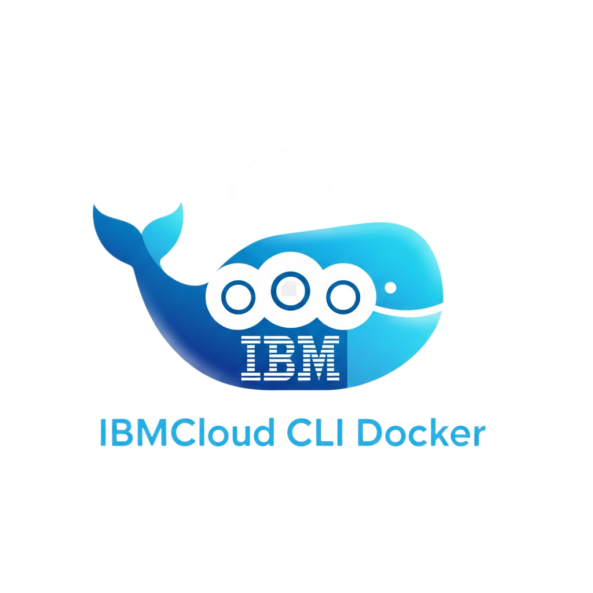

<div align="center">

> ⚠️ **Maintenance Notice**
>
> This repository is **no longer actively maintained**. Since its creation, IBM Cloud tools have evolved significantly, and I no longer use IBM Cloud in my daily work. The image may still work, but I won't be providing updates or support.
>
> Consider using [IBM Cloud Official Docker Images](https://github.com/IBM/ibmcloud-docker-image) or the [IBM Cloud CLI directly](https://github.com/IBM/ibmcloud-cli).



# IBMCloud CLI Docker Image

### A minimalist Docker image with IBMCloud CLI ready for CI/CD and development

[](https://hub.docker.com/r/oda2/ibmcloud-cli)
[](https://hub.docker.com/r/oda2/ibmcloud-cli)
[](https://github.com/Oda2/docker-ibmcloud-cli)
[](LICENSE)
[](https://github.com/Oda2/docker-ibmcloud-cli/actions)

---

## ✨ Why Use This?

- ✅ **Zero installation** - Comes with IBMCloud CLI and all plugins pre-installed
- ✅ **CI/CD ready** - Set environment variables and you're ready to go
- ✅ **Small footprint** - Alpine-based image for minimal size
- ✅ **Always up-to-date** - ~~Automatic builds with the latest version~~ (builds paused)

</div>

---

## 📋 Table of Contents

- [Quick Start](#quick-start)
- [Environment Variables](#environment-variables)
- [CI/CD Usage](#cicd-usage)
- [Installed Plugins](#installed-plugins)
- [Advanced Examples](#advanced-examples)
- [Contributing](#contributing)
- [License](#license)

---

## 🚀 Quick Start

### Basic Usage

```bash
docker run -it \
  -e IBM_CLOUD_API_KEY=$IBM_CLOUD_API_KEY \
  -e IBM_CLOUD_REGION=us-south \
  oda2/ibmcloud-cli
```

### With Docker Compose

```yaml
services:
  ibmcloud:
    image: oda2/ibmcloud-cli
    environment:
      IBM_CLOUD_API_KEY: ${IBM_CLOUD_API_KEY}
      IBM_CLOUD_REGION: us-south
    volumes:
      - ./scripts:/scripts
    command: /bin/bash
```

---

## 🔧 Environment Variables

| Variable | Required | Description | Default |
|----------|----------|-------------|---------|
| `IBM_CLOUD_API_KEY` | ✅ | Your IBM Cloud API Key | - |
| `IBM_CLOUD_REGION` | ✅ | Region for login | `us-south` |
| `IBM_CLOUD_RESOURCE_GROUP` | ❌ | Resource group | `default` |

> 🔐 **Tip**: Never expose your API Key in public repositories! Use CI/CD secrets.

---

## 🔄 CI/CD Usage

### GitHub Actions

```yaml
jobs:
  deploy:
    runs-on: ubuntu-latest
    steps:
      - name: Login to IBM Cloud
        uses: oda2/docker-ibmcloud-cli@v1
        with:
          api-key: ${{ secrets.IBM_CLOUD_API_KEY }}
          region: us-south

      - name: List clusters
        run: ibmcloud ks cluster ls
```

### GitLab CI

```yaml
deploy:
  image: oda2/ibmcloud-cli
  variables:
    IBM_CLOUD_API_KEY: $IBM_CLOUD_API_KEY
    IBM_CLOUD_REGION: us-south
  script:
    - ibmcloud ks cluster ls
```

### Jenkins

```groovy
pipeline {
    agent {
        docker {
            image 'oda2/ibmcloud-cli'
            args '-e IBM_CLOUD_API_KEY=$IBM_CLOUD_API_KEY -e IBM_CLOUD_REGION=us-south'
        }
    }
    stages {
        stage('Deploy') {
            steps {
                sh 'ibmcloud ks cluster ls'
            }
        }
    }
}
```

### Azure DevOps

```yaml
- task: Docker@2
  inputs:
    command: 'run'
    imageName: 'oda2/ibmcloud-cli'
    containerCommand: 'ibmcloud ks cluster ls'
    envVars: |
      IBM_CLOUD_API_KEY=$(IBM_CLOUD_API_KEY)
      IBM_CLOUD_REGION=us-south
```

---

## 📦 Installed Plugins

| Plugin | Description |
|--------|-------------|
| `kubernetes-service` | Kubernetes cluster management (IKS) |
| `container-registry` | Docker image management in IBM Cloud Container Registry |
| `schematics` | Infrastructure as Code (IaC) with Terraform |
| `cloud-object-storage` | Object Storage management |

### Checking Plugins

```bash
$ ibmcloud plugin list

Listing installed plug-ins...

Plugin Name          Version   Status
cloud-object-storage  1.3.1    Update Available
container-registry    0.1.567   Update Available
kubernetes-service    0.3.254   Update Available
schematics            0.0.27    Update Available
```

---

## 💡 Advanced Examples

### Running Specific Commands

```bash
docker run --rm \
  -e IBM_CLOUD_API_KEY=$IBM_CLOUD_API_KEY \
  -e IBM_CLOUD_REGION=us-south \
  oda2/ibmcloud-cli ibmcloud ks cluster ls
```

### Using with Kubernetes

```bash
# Authenticate and get cluster credentials
docker run --rm \
  -e IBM_CLOUD_API_KEY=$IBM_CLOUD_API_KEY \
  -e IBM_CLOUD_REGION=us-south \
  oda2/ibmcloud-cli ibmcloud ks cluster config --cluster my-cluster

# Download kubeconfig
docker run --rm \
  -e IBM_CLOUD_API_KEY=$IBM_CLOUD_API_KEY \
  -e IBM_CLOUD_REGION=us-south \
  -v $(pwd):/output \
  oda2/ibmcloud-cli ibmcloud ks cluster config --cluster my-cluster --export > /output/kubeconfig
```

### Build and Push Images

```bash
docker run --rm \
  -e IBM_CLOUD_API_KEY=$IBM_CLOUD_API_KEY \
  -e IBM_CLOUD_REGION=us-south \
  -v /var/run/docker.sock:/var/run/docker.sock \
  -v $(pwd):/app \
  oda2/ibmcloud-cli sh -c "
    ibmcloud cr build -t registry.us-south.io/myapp:latest /app
  "
```

---

## 🤝 Contributing

Contributions are welcome! See our [Contribution Guide](./.github/CONTRIBUTING.md).

1. Fork the project
2. Create your branch (`git checkout -b feature/amazing-feature`)
3. Commit your changes (`git commit -m 'Add amazing feature'`)
4. Push to the branch (`git push origin feature/amazing-feature`)
5. Open a Pull Request

---

## 📄 License

This project is licensed under the MIT License - see the [LICENSE](LICENSE) file for details.

---

<div align="center">

### ⭐ Like it? Leave a star!

[](https://github.com/Oda2/docker-ibmcloud-cli)

Made with ❤️ by [Renato Oda](https://github.com/Oda2)

</div>
